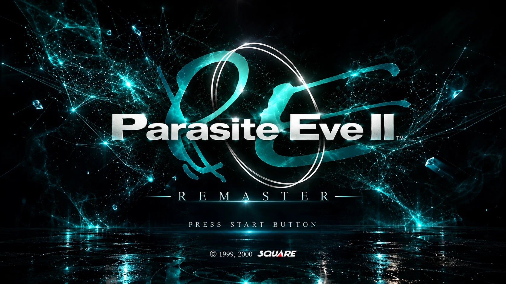
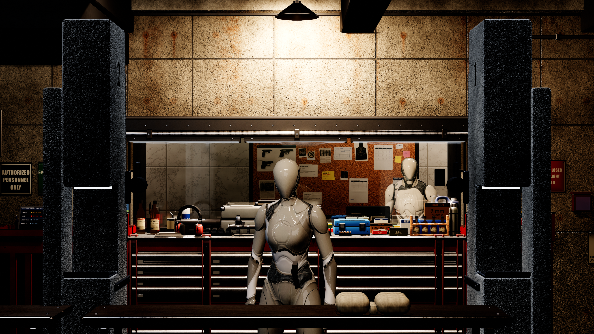
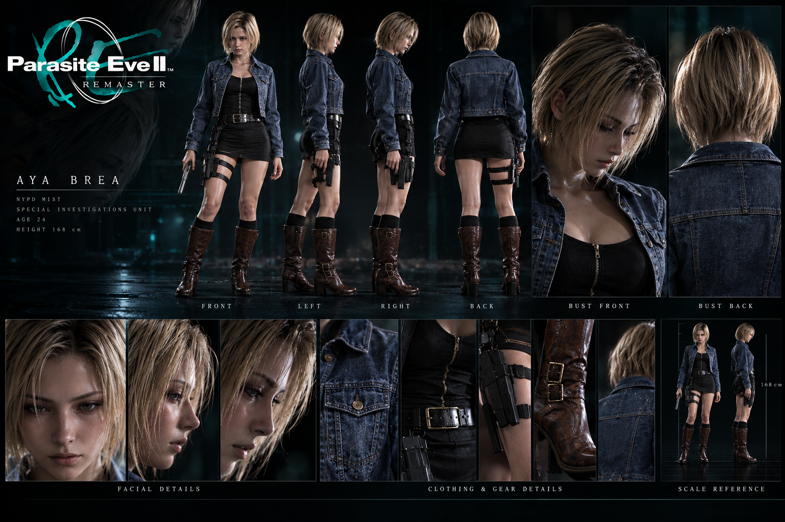
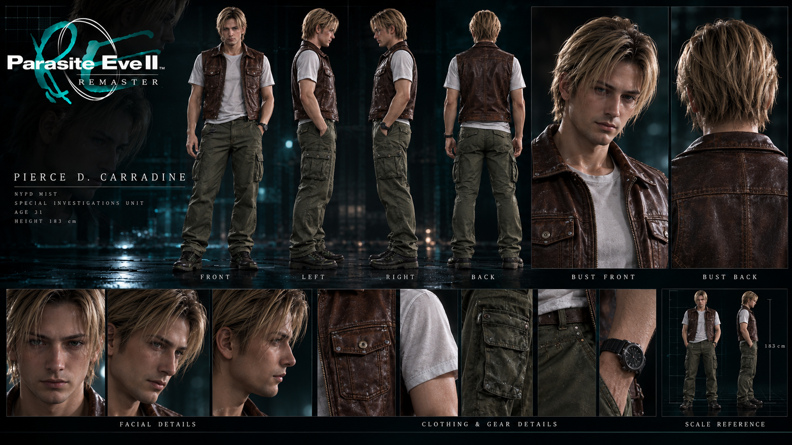
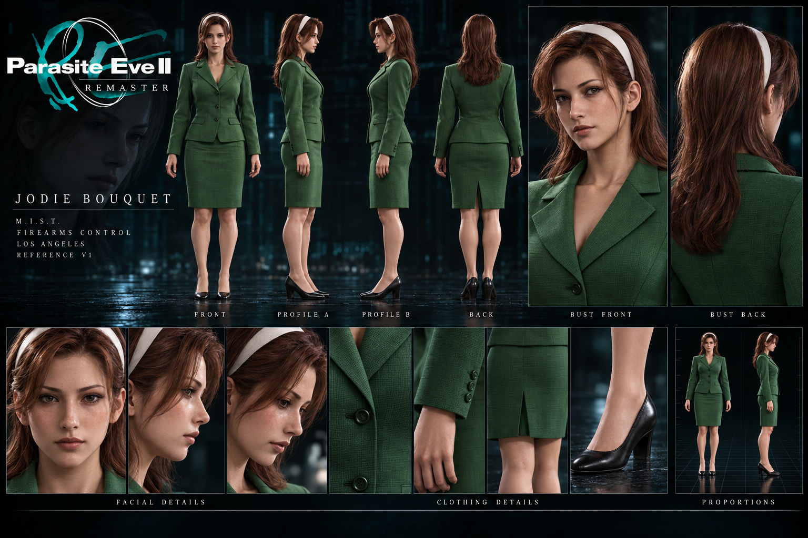
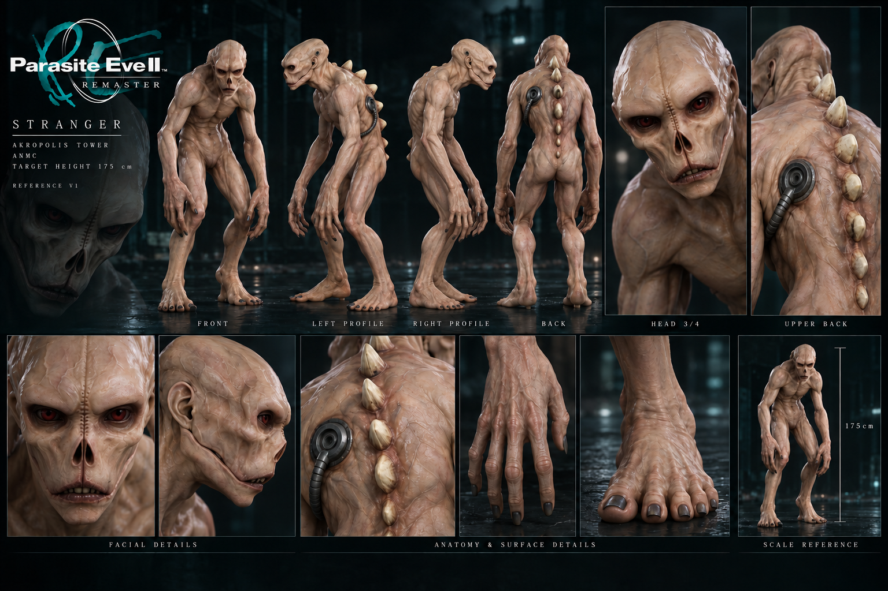

  

Illustration conceptuelle générée par IA · Direction visuelle · Ce n’est pas une capture du jeu

<h1 align="center">PARASITE EVE II · REMASTER</h1>

<strong>Un lieu familier. Reconstruit jusque dans ses détails.</strong>

Projet de fan non officiel · Alpha de développement · Unreal Engine · Réalisé sur mon temps libre

<a href="README.md">English</a> · <strong>Français</strong>

Je reconstruis l’univers de **Parasite Eve II**, en commençant par le **M.I.S.T.** : son stand de tir, ses espaces de service et les petits détails qui rendent ce lieu immédiatement reconnaissable.

L’objectif est de retrouver cette familiarité avec un environnement qui possède une vraie profondeur, des matières crédibles et des objets qui réagissent à ce qui les entoure. Un impact, une bouteille cassée ou une lampe endommagée doivent laisser une trace visible.

Ce dépôt présente les avancées du projet. Il s’agit d’une **alpha de développement**, avec des personnages provisoires et des systèmes encore incomplets. Reconstruire le jeu entier reste une ambition à long terme ; les images présentées ici se concentrent sur le M.I.S.T., tandis qu’un laboratoire séparé travaille sur le personnage jouable.

Capture Unreal Engine · alpha précoce · personnages provisoires · 3840 × 2160

## Dans l’alpha actuelle

<!-- ALPHA_STATUS_START -->
- **Déjà reconstruit :** le stand de tir du M.I.S.T., la salle de surveillance derrière son guichet et le sas-vestibule avec ses armoires d’armes, comparés aux vues fixes d’origine.
- **Détails du décor :** établis et servantes à tiroirs, valises et boîtes de munitions, tableaux et affiches, installations au plafond, un présentoir d’armes de poing et des armoires d’armes longues.
- **Matières et éclairage :** béton, métal peint et usé, bois, toile et verre, avec un travail continu sur l’usure, les reflets et la lisibilité.
- **Réactions environnementales :** impacts, bouteilles cassables, objets physiques, sons de réaction et luminaires endommageables.
- **Suivi des états :** plusieurs états d’objets peuvent être restaurés pendant la session de développement. Une sauvegarde de partie complète reste à terminer.

Les performances, les collisions et la finition visuelle demandent encore du travail. Les personnages définitifs ne sont pas encore intégrés : les mannequins sont provisoires.
<!-- ALPHA_STATUS_END -->

## Le laboratoire Aya

Le travail sur le personnage a commencé, dans un espace dédié : un laboratoire Unreal séparé où je développe les déplacements, la posture, la visée et le maniement du pistolet d’Aya, et où je les éprouve avant toute intégration au projet principal.

- **Déplacements :** repos, marche, course, déplacements en visée et pas latéraux, avec une posture redressée, une respiration et de petits mouvements au repos.
- **Visée et prise en main :** sa propre pose de visée, des bras et des poignets corrigés, le pistolet tenu dans sa propre main, une main de soutien placée comme le décrivent les manuels de tir, l’index sur la détente.
- **Rechargements :** un rechargement à vide refait étape par étape : glissière bloquée en arrière, chargeur vide lâché, nouveau chargeur, glissière relâchée. Le rechargement tactique et l’inspection courte sont prototypés et restent à adapter.
- **Réactions au tir :** mouvement de la glissière, recul des bras, flash de bouche variable, et douilles qui rebondissent, roulent puis s’immobilisent.
- **Une expérimentation :** un petit easter egg pour qui insiste pour recharger une arme déjà pleine.

Le personnage animé dans le laboratoire est une base féminine provisoire, pas Aya, dont l’apparence définitive est encore en recherche. Rien de tout cela n’est encore dans le projet principal, et il n’y a pas de nouvelles images du personnage pour l’instant. [Lire le compte rendu complet du laboratoire →](docs/PROGRESS.fr.md#le-laboratoire-aya--point-du-12-octobre-2026)

## Cadrages originaux, environnements reconstruits

<!-- COMPARISONS_START -->
Chaque planche place l’**original** (à gauche) à côté de l’**alpha** (à droite), au même cadrage de référence. Cliquez sur une planche pour ouvrir la capture native intacte (3840 × 2880). L’original est une référence de 320 × 240, agrandie pour la présentation seulement. Les personnages sont des mannequins provisoires.

*Stand de tir du M.I.S.T. · planche 3840 × 2160 · [capture native 3840 × 2880](media/alpha/mist-view15-4x3.png)*

*Salle de surveillance · planche 3840 × 2160 · [capture native 3840 × 2880](media/alpha/mist-pierce-4x3.png)*

*Sas-vestibule, ses armoires d’armes et ses panneaux d’affichage · planche 3840 × 2160 · [capture native 3840 × 2880](media/alpha/mist-vestibule-4x3.png)*

Alpha précoce : les poses des personnages ne reprennent pas celles des originaux, et chaque espace fera l’objet d’une nouvelle passe détaillée. D’autres vues seront ajoutées à mesure de leur reconstruction.
<!-- COMPARISONS_END -->

### Pourquoi montrer aussi du 16:9 ?

Les références originales sont en **4:3**. Elles restent la base pour comparer la disposition et la composition.

L’**image 16:9** conserve le même champ de vision vertical que la référence 4:3. La zone 4:3 centrée (2880 des 3840 pixels) correspond donc au cadrage de référence, et les 480 pixels de chaque côté montrent un espace reconstruit supplémentaire. Le [repère de cadrage](media/wide/mist-view15-guide.png) délimite la zone 4:3 ; la [capture native 16:9](media/wide/mist-view15-16x9.png) est publiée intacte.

Le champ de tir vu depuis le pas de tir, avec le même cadre 4:3 :

[Autres vues en 16:9 : les stands, la salle de surveillance, le sas →](docs/GALLERY.fr.md#autres-vues-en-169)

## Direction visuelle

La couverture et les fiches de personnages sont des **références conceptuelles générées par IA**, distinctes des captures Unreal. Elles explorent une direction artistique ; elles ne montrent pas des personnages terminés et animés dans le jeu. Dryfield sur la couverture est une illustration conceptuelle, pas une zone jouable présentée par cette alpha.

  
  
  
  

Aya · Pierce · Jodie · Créature — fiches conceptuelles générées par IA · Direction visuelle · Ce ne sont pas les personnages intégrés

[Découvrir la galerie de concepts →](docs/CONCEPTS.fr.md)

## La suite

- Étendre le M.I.S.T. à ses autres espaces connectés.
- Renforcer la fidélité et les interactions du décor.
- Consolider les commandes, les collisions et les performances.
- Dans le laboratoire Aya : adapter le rechargement tactique et l’inspection courte, puis ajouter la visée vers le haut et vers le bas et les sons du pistolet.
- Poursuivre la recherche de l’apparence définitive d’Aya, et intégrer les systèmes du laboratoire au projet principal une fois qu’ils seront solides.

Les textes sont prévus en **anglais et en français**. Les voix et les cinématiques sont des pistes pour une phase ultérieure, pas des fonctionnalités de l’alpha actuelle.

Le projet avance sur mon temps libre : **aucune date de sortie ni estimation de délai**. Ce dépôt ne contient pas de version jouable publique.

## Vos retours sont les bienvenus

Si vous connaissez bien PE2, vos remarques sur l’éclairage, les matières, la disposition et l’ambiance m’intéressent. Une capture de référence accompagnée d’une observation précise est particulièrement utile.

[Guide des retours](CONTRIBUTING.md) · [Avancement](docs/PROGRESS.fr.md) · [Crédits et notes sur les images](NOTICE.md)

*Parasite Eve II appartient à ses créateurs et ayants droit d’origine. Ce projet de fan est indépendant et non officiel, sans affiliation ni approbation de Square Enix. Cette vitrine contient de la documentation et des images sélectionnées ; elle ne distribue ni le jeu original ni ses ressources extraites.*
