

  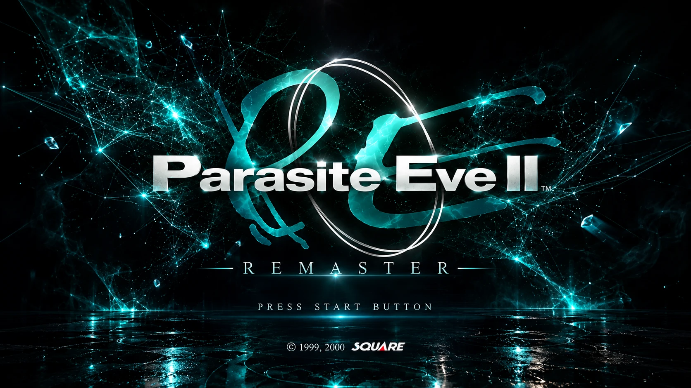

Écran titre

<h1 align="center">PARASITE EVE II · REMASTER</h1>

<strong>Un lieu familier. Reconstruit jusque dans ses détails.</strong>

Projet de fan non officiel · Alpha de développement · Unreal Engine · Réalisé sur mon temps libre

<a href="README.md">English</a> · <strong>Français</strong>

Je reconstruis l’univers de **Parasite Eve II**, en commençant par le **M.I.S.T.** : son stand de tir, ses espaces de service et les petits détails qui rendent ce lieu immédiatement reconnaissable.

L’objectif est de retrouver cette familiarité avec un environnement qui possède une vraie profondeur, des matières crédibles et des objets qui réagissent à ce qui les entoure. Un impact, une bouteille cassée ou une lampe endommagée doivent laisser une trace visible.

Ce dépôt présente les avancées du projet. Il s’agit d’une **alpha de développement**, avec des personnages provisoires et des systèmes encore incomplets. Reconstruire le jeu entier reste une ambition à long terme ; les images présentées ici se concentrent sur le M.I.S.T., tandis qu’un laboratoire séparé travaille sur le personnage jouable.

<a href="media/wide/mist-view15-16x9.png">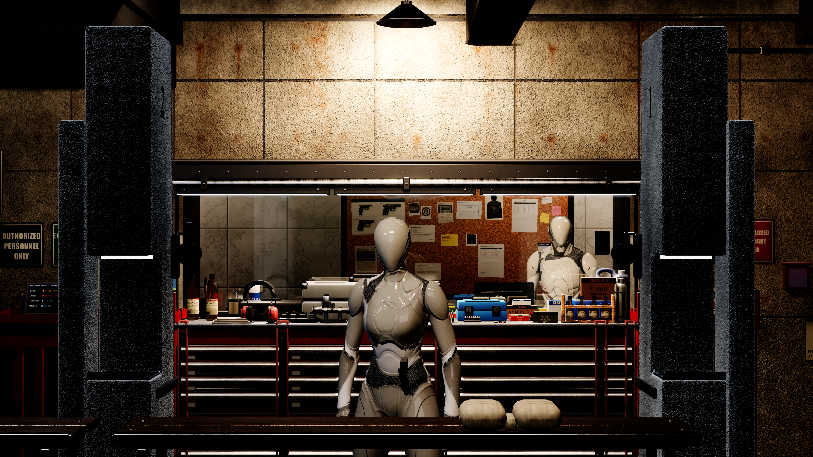</a>

Capture Unreal Engine · alpha précoce · personnages provisoires · 3840 × 2160

## Trois façons de jouer · novembre 2026

Trois façons de jouer sont prévues : les caméras fixes d’origine en 4:3, les mêmes caméras fixes en 16:9, et un mode remaster avec une nouvelle caméra moderne. Voici le même moment dans l’armurerie dans les trois cas : Aya au comptoir, face à Jodie derrière le grillage. Les personnages sont des mannequins Unreal Engine provisoires.

<a href="media/alpha/mist-armoury-modes-fixed-4x3.png">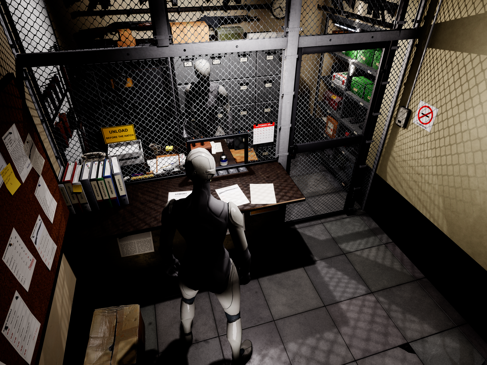</a>

1 · Caméra fixe d’origine, 4:3 · capture native 3840 × 2880 · mannequins provisoires

<a href="media/wide/mist-armoury-modes-fixed-16x9.png">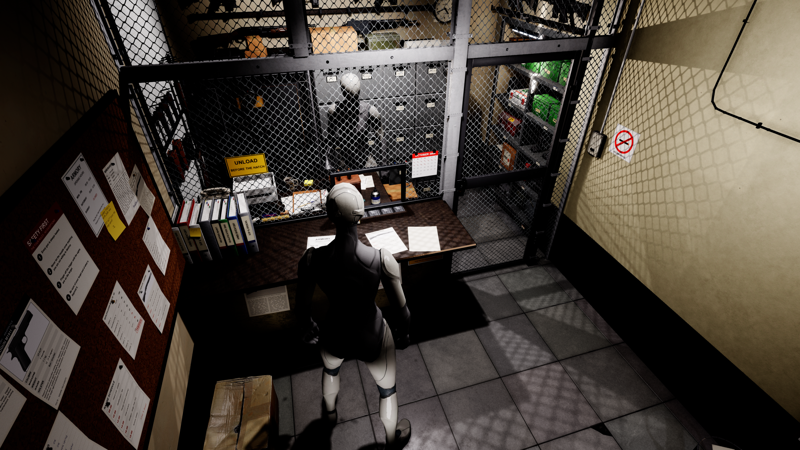</a>

2 · Caméra fixe d’origine, 16:9 · le même cadrage, élargi sur les côtés · capture native 3840 × 2160

<a href="media/wide/mist-armoury-modes-new-camera-16x9.png">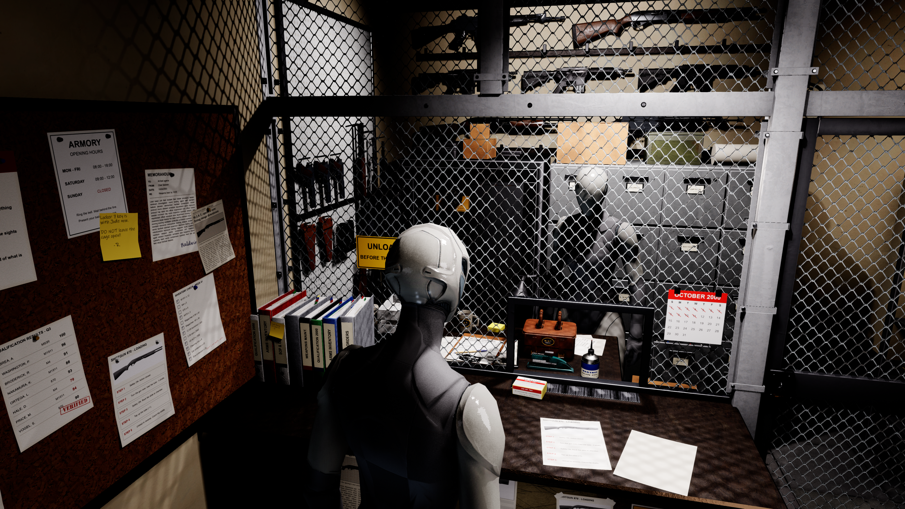</a>

3 · Mode remaster, nouvelle caméra, 16:9 · Aya face à Jodie au comptoir · capture native 3840 × 2160

## M.I.S.T. · début novembre 2026

**Des lumières placées là où l’original les montre.** Dans la salle de surveillance et le hall qui mène au bureau de Pierce, chaque luminaire se trouve désormais là où les vues fixes de l’original en montrent un : une bouche d’aération ronde au plafond du hall, les réglettes, un rail de spots le long des tableaux et une lumière sous la hotte du bureau. Chaque lumière sort de son luminaire.

**Le poste de Pierce fini.** Le bureau, le hall et leurs petits détails ont reçu une passe de finition, jugée avec les réglages du jeu lui-même plutôt que dans l’éditeur.

**Plus de retenue sur les sols.** Après vos retours sur l’armurerie, le détail photographié des sols a été atténué, pour qu’aucune surface ne paraisse plus réaliste que le reste de la pièce.

[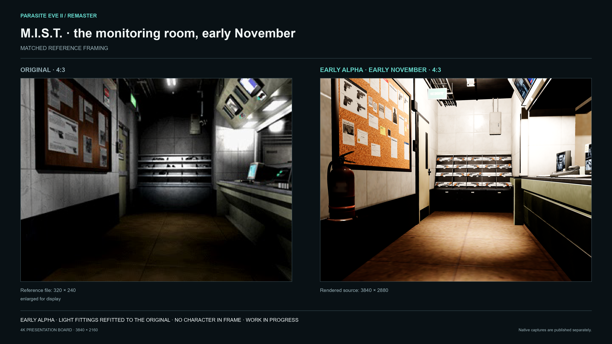](media/alpha/mist-monitoring-room-nov-4x3.png)
*La salle de surveillance · début novembre · [capture native 3840 × 2880](media/alpha/mist-monitoring-room-nov-4x3.png)*

[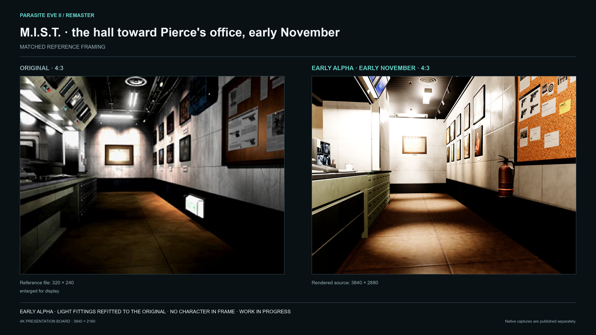](media/alpha/mist-hall-nov-4x3.png)
*Le hall vers le bureau de Pierce · début novembre · [capture native 3840 × 2880](media/alpha/mist-hall-nov-4x3.png)*

## Akropolis · le parvis de la tour en décor réel · novembre 2026

Le premier lieu jouable d’Akropolis est le parvis au pied de la tour : la nuit de l’attaque, des voitures de police, un camion de pompiers et une ambulance devant les portes. Dans l’original, c’est un décor pré-calculé ; ici, c’est un vrai lieu que l’on traverse, reconstruit et vérifié image par image face à l’original, au même cadrage.

- **Mesuré, pas deviné.** Les marquages au sol, le tapis rouge et son lettrage, le parvis en marbre et le bitume sont placés là où l’original les montre, relevés sur ses images au centimètre près. L’entrée de la tour (granit rouge, applique, portes vitrées, grilles roulantes, colonne dorée) est relevée de la même façon, de face.
- **Modélisé pour le projet.** Le camion de pompiers, l’ambulance aux portes arrière ouvertes, les barrières POLICE LINE, le brancard, les cônes et les fusées de détresse. Les surfaces et les plantes viennent de matières photographiées.
- **Éclairé comme l’original.** Chaque lumière est dans un luminaire que montre l’original : les lampadaires, les gyrophares du camion, l’ambulance, les spots de l’auvent, les projecteurs du massif. Le niveau et la couleur de la lumière sont mesurés face à l’original, zone par zone, plutôt que réglés à l’œil.

- **Le sol, de près.** Le bitume est maintenant une vraie chaussée photographiée, usée, jamais identique d’un endroit à l’autre. Il porte ce que porte une vraie allée de ville : des fissures colmatées au goudron, des réparations découpées à la scie autour des plaques d’égout, une peinture usée, des gouttes d’huile au milieu des voies. Autour des tuyaux du camion, le sol est trempé, l’eau stagne dans ses vrais creux et les bottes mouillées des pompiers laissent leurs empreintes jusqu’aux portes. Le tapis rouge fait des plis, et sa couleur comme celle du marbre sont maintenant mesurées face à l’original.

Alpha précoce : les personnages et les gyrophares animés restent à venir.

[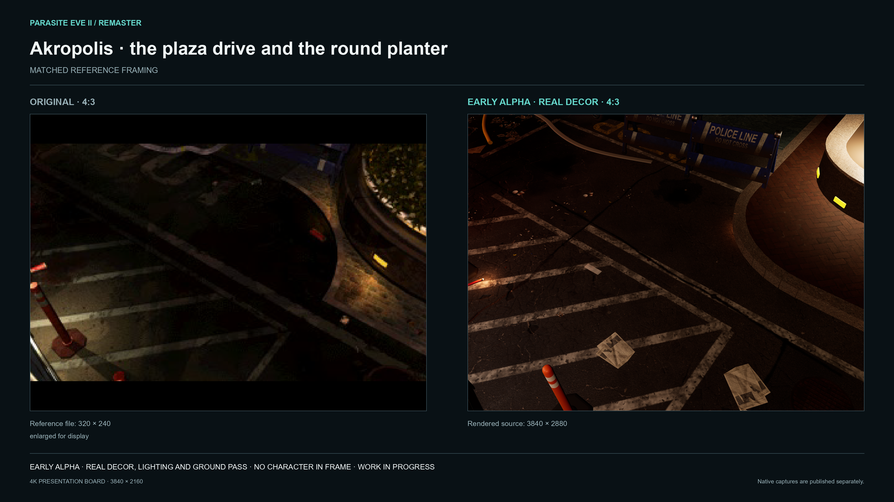](media/alpha/akropolis-plaza-drive-4x3.png)
*L’allée et le massif rond · décor réel · [capture native 3840 × 2880](media/alpha/akropolis-plaza-drive-4x3.png)*

[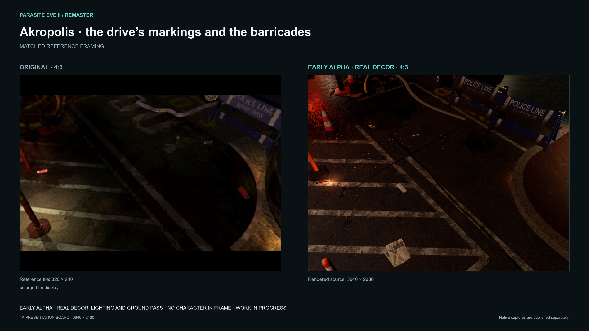](media/alpha/akropolis-plaza-markings-4x3.png)
*Les marquages de l’allée et les barrières · la passe du sol · [capture native 3840 × 2880](media/alpha/akropolis-plaza-markings-4x3.png)*

[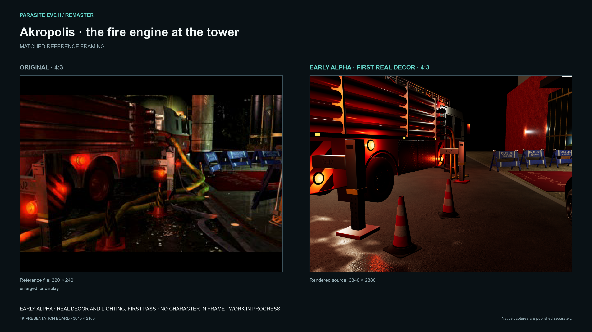](media/alpha/akropolis-plaza-fire-engine-4x3.png)
*Le camion de pompiers devant la tour, le sol trempé autour des tuyaux · décor réel · [capture native 3840 × 2880](media/alpha/akropolis-plaza-fire-engine-4x3.png)*

[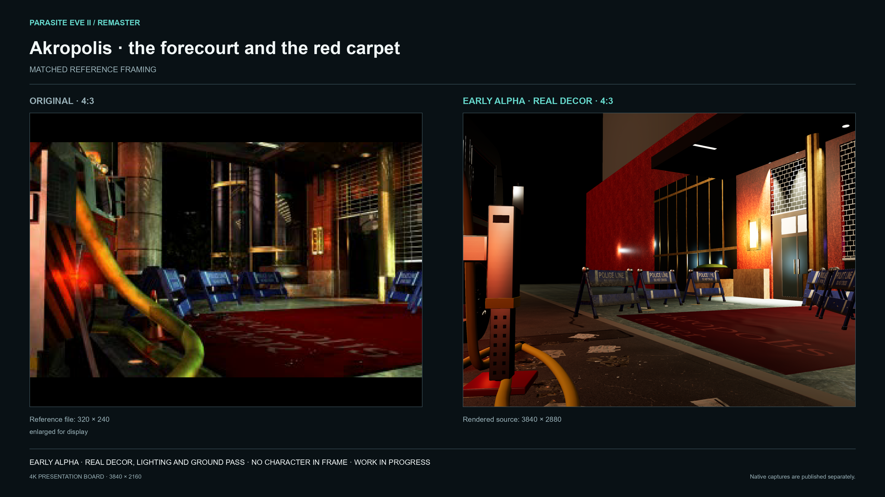](media/alpha/akropolis-plaza-forecourt-4x3.png)
*Le parvis et le tapis rouge · décor réel · [capture native 3840 × 2880](media/alpha/akropolis-plaza-forecourt-4x3.png)*

[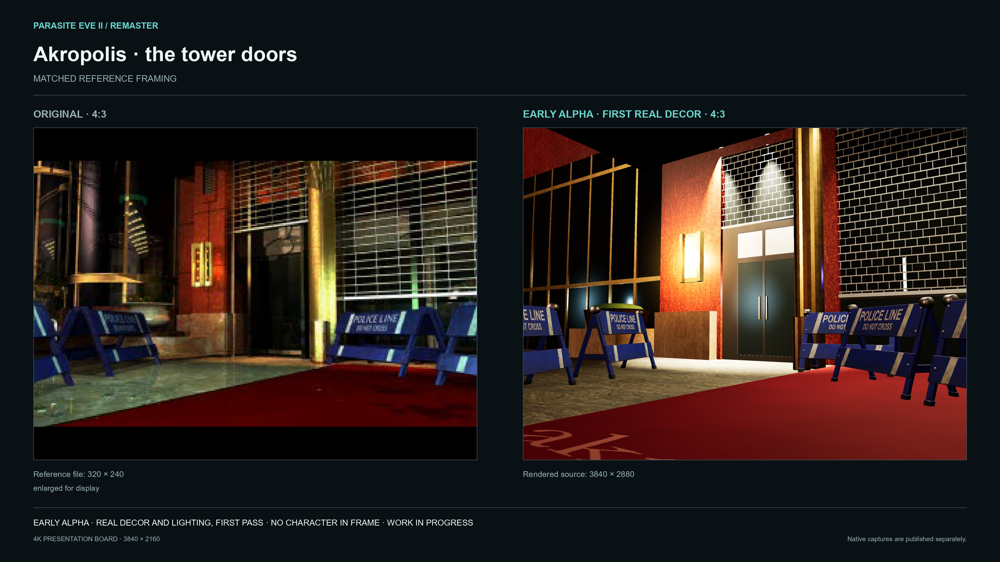](media/alpha/akropolis-plaza-doors-4x3.png)
*Les portes de la tour · décor réel · [capture native 3840 × 2880](media/alpha/akropolis-plaza-doors-4x3.png)*

[Détails](docs/PROGRESS.fr.md#akropolis-parvis-de-la-tour--point-du-9-novembre-2026)

## Nouveautés · fin octobre 2026

**Des matières photographiées dans tout le M.I.S.T.** Sols, béton, plâtre, métal peint, bois, papier et carton utilisent désormais des surfaces photographiées, accordées aux couleurs d’origine. Chaque sol carrelé porte sa propre usure sur toute la pièce, au lieu de la même marque répétée sur chaque carreau.

**Une armurerie détaillée.** Une cage en grillage galvanisé tissé, avec ses fixations, ses boulons, ses charnières et son cadenas ; des classeurs usés, des feuilles qui gondolent, un carton cabossé et les petits objets d’un vrai bureau ; de vraies ombres qui posent chaque objet sur son support.

**La salle de surveillance et l’armurerie, recalées sur l’original (30 octobre).** Le présentoir à pistolets de la salle de surveillance est refait d’après l’image originale : quatre gradins inclinés, les armes posées à plat et câblées. Dans l’armurerie, la cage suit maintenant l’original : un seul rail haut, un portillon sombre, et le comptoir fermé par le grillage avec un unique passe-objets. Les papiers du bureau sont passés du côté de l’armurière, et une lampe dans la cage projette l’ombre du grillage sur le mur, comme dans l’original. [Détails](docs/PROGRESS.fr.md#salle-de-surveillance-et-armurerie-du-mist--point-du-30-octobre-2026)

**La porte de la zone d’accès restreint, détaillée avec du vrai matériel (1er novembre).** Chaque équipement reprend un produit réel : une barre antipanique Von Duprin 99, un ferme-porte LCN 4041 sur le dormant, un tableau électrique Square D NQ, une plaque signalétique rivetée, un panneau NO SMOKING en aluminium. La porte, les murs et les stickers portent leur propre usure, là où l’on touche, pousse et frappe. [Détails](docs/PROGRESS.fr.md#porte-de-la-zone-daccès-restreint-du-mist--point-du-1er-novembre-2026)

**Ce dépôt est le meilleur endroit pour suivre le projet.** Il est mis à jour au fil du travail, avec de nouvelles comparaisons, des captures natives et des notes d’avancement datées.

**[Évolution en images](docs/EVOLUTION.fr.md).** Chaque plan fixe du M.I.S.T. au fil d’octobre, de la première version complète à aujourd’hui, au même cadrage que l’original.

<a href="media/comparisons/mist-armoury-detail-4x3.png">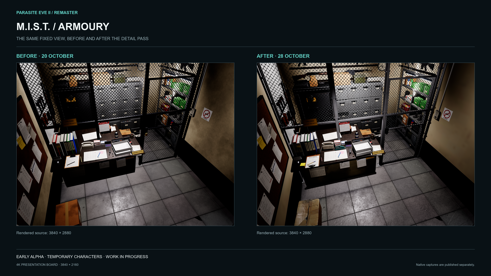</a>

L’armurerie du M.I.S.T. · le même plan fixe avant (20 octobre) et après (28 octobre) la passe de détail · planche 3840 × 2160 · <a href="media/alpha/mist-armoury-before-4x3.png">avant</a> · <a href="media/alpha/mist-armoury-after-4x3.png">après</a>

## Nouveautés · octobre 2026

**M.I.S.T. s’agrandit.** Au-delà du stand de tir et du sas, l’alpha couvre désormais le couloir de service, la zone d’accès restreint et son armurerie, et le parking souterrain, chacun reconstruit d’après les plans fixes d’origine.

**Une destruction qui a une cause.** Chaque balle arrive là où elle est visée et transporte son énergie à travers ce qu’elle touche. Elle traverse une vitre et atteint l’arme derrière ; une charnière plie, puis cède ; une porte libérée tombe au sol ; un support lâche et les armes basculent ; un carreau éclate de son mur ; un extincteur se vide et tombe. Les dégâts restent en place et peuvent être sauvegardés puis restaurés.

**Un nouveau lieu : Akropolis.** Toute la zone d’Akropolis a été cartographiée et reconstruite en structure praticable : dix-sept zones reliées par vingt portes fonctionnelles, avec plus de deux cents plans fixes d’origine en place. La première passe de décor a commencé sur la promenade en plein air, la chapelle et le belvédère. Les matières et l’éclairage restent à venir.

<a href="media/comparisons/mist-armoury-4x3.png">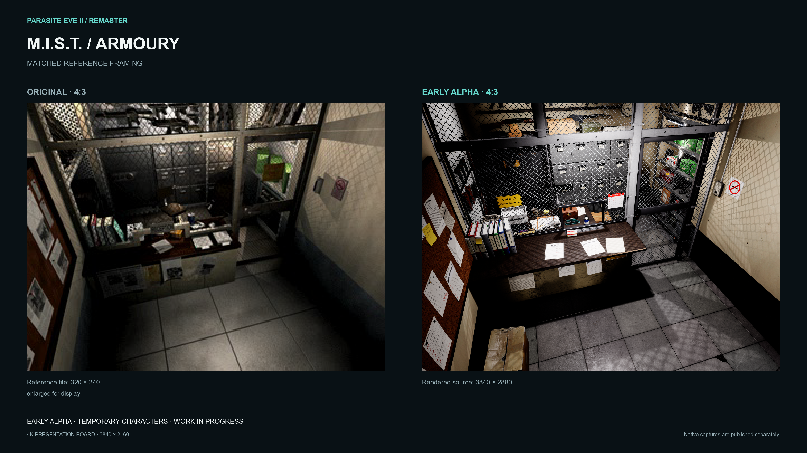</a>

L’armurerie du M.I.S.T. · référence d’origine (à gauche) et alpha (à droite) · planche 3840 × 2160

## Dans l’alpha actuelle

<!-- ALPHA_STATUS_START -->
- **Déjà reconstruit :** le stand de tir du M.I.S.T., la salle de surveillance derrière son guichet, le sas-vestibule avec ses armoires d’armes, le couloir de service, la zone d’accès restreint et son armurerie, et le parking souterrain, comparés aux vues fixes d’origine. Akropolis existe en structure praticable, avec son premier décor.
- **Détails du décor :** établis et servantes à tiroirs, valises et boîtes de munitions, tableaux et affiches, installations au plafond, un présentoir d’armes de poing et des armoires d’armes longues.
- **Matières et éclairage :** béton, métal peint et usé, bois, toile et verre, avec un travail continu sur l’usure, les reflets et la lisibilité.
- **Réactions environnementales :** impacts, bouteilles cassables, objets physiques, sons de réaction et luminaires endommageables. Les armoires d’armes, un mur carrelé et l’extincteur se brisent désormais pièce par pièce, là où ils sont touchés.
- **Suivi des états :** trous, marques, portes tombées, armes renversées et extincteur qui se vide sont sauvegardés et restaurés à l’identique pendant la session de développement. Une sauvegarde de partie complète reste à terminer.

Les performances, les collisions et la finition visuelle demandent encore du travail. Les personnages définitifs ne sont pas encore intégrés : les mannequins sont provisoires, et les nouvelles images montrent les lieux sans personnage.
<!-- ALPHA_STATUS_END -->

## Le laboratoire Aya

Le travail sur le personnage a commencé, dans un espace dédié : un laboratoire Unreal séparé où je développe les déplacements, la posture, la visée et le maniement du pistolet d’Aya, et où je les éprouve avant toute intégration au projet principal.

- **Déplacements :** repos, marche, course, déplacements en visée et pas latéraux, avec une posture redressée, une respiration et de petits mouvements au repos.
- **Visée et prise en main :** sa propre pose de visée, des bras et des poignets corrigés, le pistolet tenu dans sa propre main, une main de soutien placée comme le décrivent les manuels de tir, l’index sur la détente.
- **Rechargements :** un rechargement à vide refait étape par étape : glissière bloquée en arrière, chargeur vide lâché, nouveau chargeur, glissière relâchée. Le rechargement tactique et l’inspection courte sont prototypés et restent à adapter.
- **Réactions au tir :** mouvement de la glissière, recul des bras, flash de bouche variable, et douilles qui rebondissent, roulent puis s’immobilisent.
- **Une expérimentation :** un petit easter egg pour qui insiste pour recharger une arme déjà pleine.

Le personnage animé dans le laboratoire est une base féminine provisoire, pas Aya, dont l’apparence définitive est encore en recherche. Rien de tout cela n’est encore dans le projet principal, et il n’y a pas de nouvelles images du personnage pour l’instant. [Lire le compte rendu complet du laboratoire →](docs/PROGRESS.fr.md#le-laboratoire-aya--point-du-12-octobre-2026)

## Cadrages originaux, environnements reconstruits

<!-- COMPARISONS_START -->
Chaque planche place l’**original** (à gauche) à côté de l’**alpha** (à droite), au même cadrage de référence. Cliquez sur une planche pour ouvrir la capture native intacte (3840 × 2880). L’original est une référence de 320 × 240, agrandie pour la présentation seulement. Les personnages sont des mannequins provisoires.

[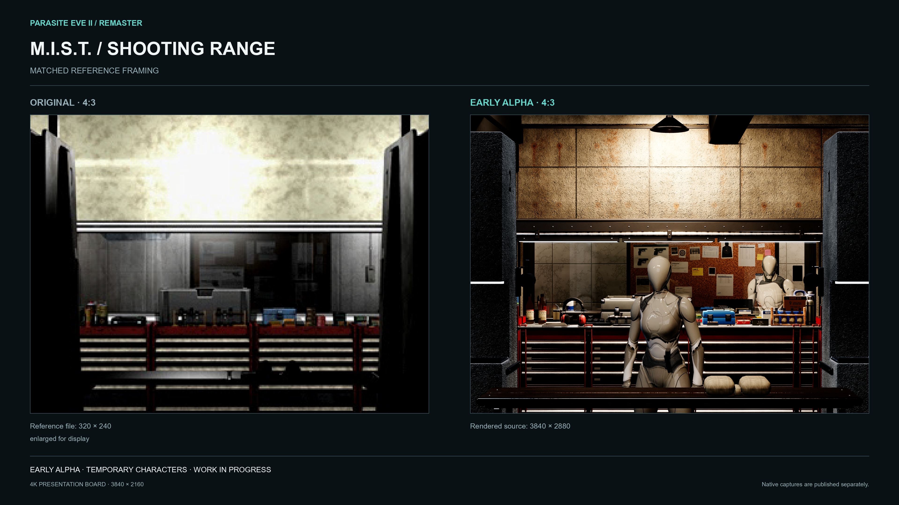](media/alpha/mist-view15-4x3.png)
*Stand de tir du M.I.S.T. · planche 3840 × 2160 · [capture native 3840 × 2880](media/alpha/mist-view15-4x3.png)*

[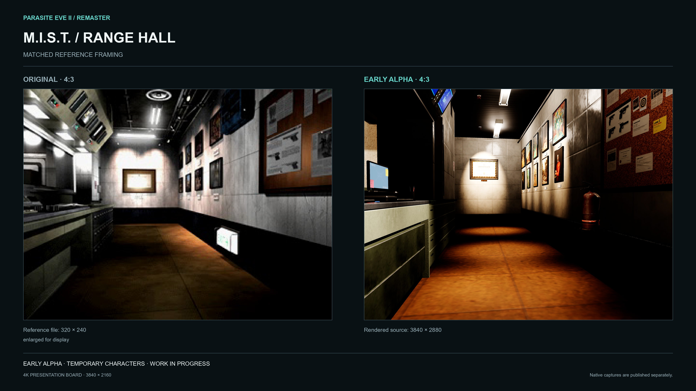](media/alpha/mist-hall-4x3.png)
*Le hall devant le stand, ses tableaux et son panneau d’affichage · planche 3840 × 2160 · [capture native 3840 × 2880](media/alpha/mist-hall-4x3.png)*

[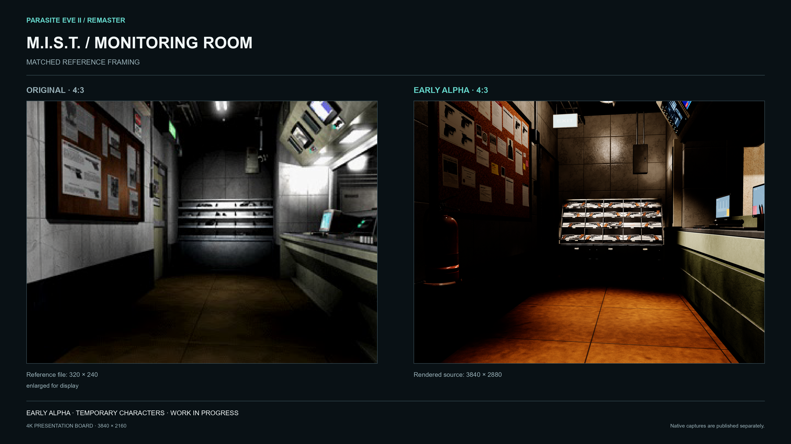](media/alpha/mist-pierce-4x3.png)
*Salle de surveillance · planche 3840 × 2160 · [capture native 3840 × 2880](media/alpha/mist-pierce-4x3.png)*

[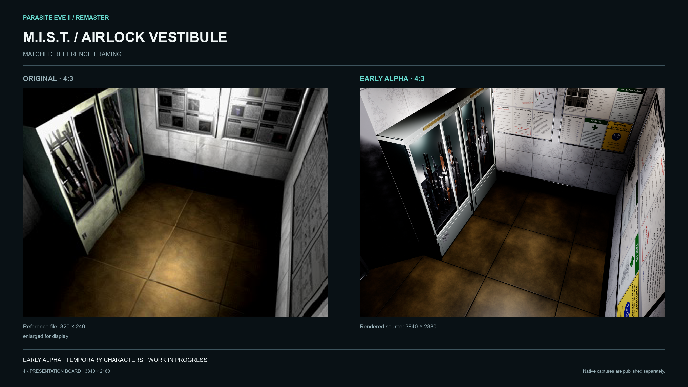](media/alpha/mist-vestibule-4x3.png)
*Sas-vestibule, ses armoires d’armes et ses panneaux d’affichage · planche 3840 × 2160 · [capture native 3840 × 2880](media/alpha/mist-vestibule-4x3.png)*

*L’armurerie derrière sa cage grillagée · planche 3840 × 2160 · [capture native 3840 × 2880](media/alpha/mist-armoury-4x3.png)*

[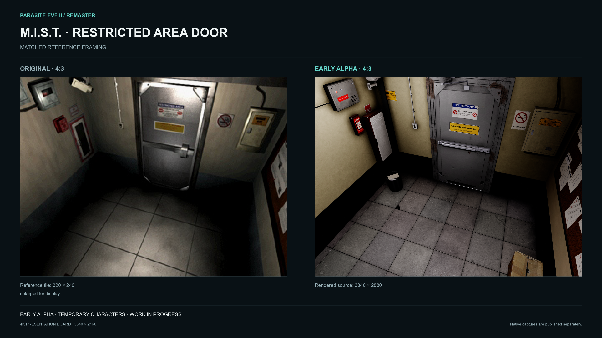](media/alpha/mist-restricted-door-4x3.png)
*La porte de la zone d’accès restreint et sa barre antipanique · planche 3840 × 2160 · [capture native 3840 × 2880](media/alpha/mist-restricted-door-4x3.png)*

[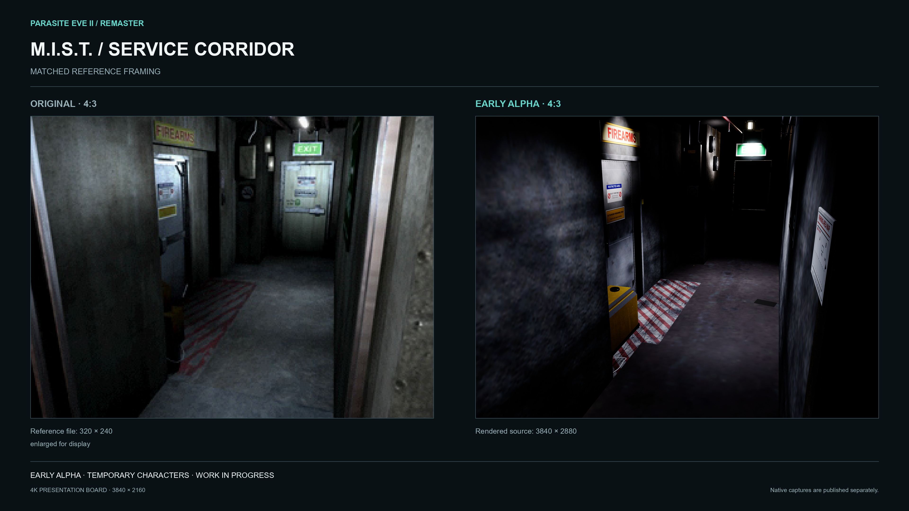](media/alpha/mist-corridor-4x3.png)
*Le couloir de service vers la réserve d’armes · planche 3840 × 2160 · [capture native 3840 × 2880](media/alpha/mist-corridor-4x3.png)*

Alpha précoce : les poses des personnages ne reprennent pas celles des originaux, et chaque espace fera l’objet d’une nouvelle passe détaillée. D’autres vues seront ajoutées à mesure de leur reconstruction.
<!-- COMPARISONS_END -->

## Une destruction qui se lit

Dans cette alpha, tirer doit laisser une histoire derrière soi. Une balle rencontre un point, une pièce, une matière ; la suite en découle, jamais d’une jauge de vie globale. Une vitre se troue et laisse passer la balle avec moins d’énergie, une serrure ou une charnière peut être détruite seule, une porte que plus rien ne retient tombe et reste au sol, et les morceaux se posent là où ils retombent.

[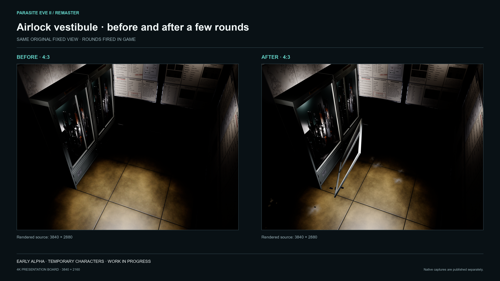](media/alpha/mist-vestibule-after-4x3.png)
*Le sas-vestibule au même plan fixe d’origine, avant et après quelques tirs : une vitre trouée, la serrure et les charnières touchées, la porte vitrée à terre · [avant](media/alpha/mist-vestibule-before-4x3.png) · [après](media/alpha/mist-vestibule-after-4x3.png)*

Les mêmes règles valent à toutes les cadences d’image, et l’état complet d’une armoire brisée se sauvegarde et se restaure à l’identique.

## Prochaine étape : Akropolis

Akropolis est reconstruite de la même façon, en commençant par sa structure. Chaque zone, chaque passage et chaque plan fixe d’origine de la zone sont en place et praticables ; la première passe de décor donne leur vraie forme aux grands volumes. Ce que vous voyez ci-dessous, c’est cette **passe de structure** : des volumes sans textures et un éclairage provisoire, posés sur les cadrages d’origine pour vérifier la disposition avant d’ajouter le moindre détail.

[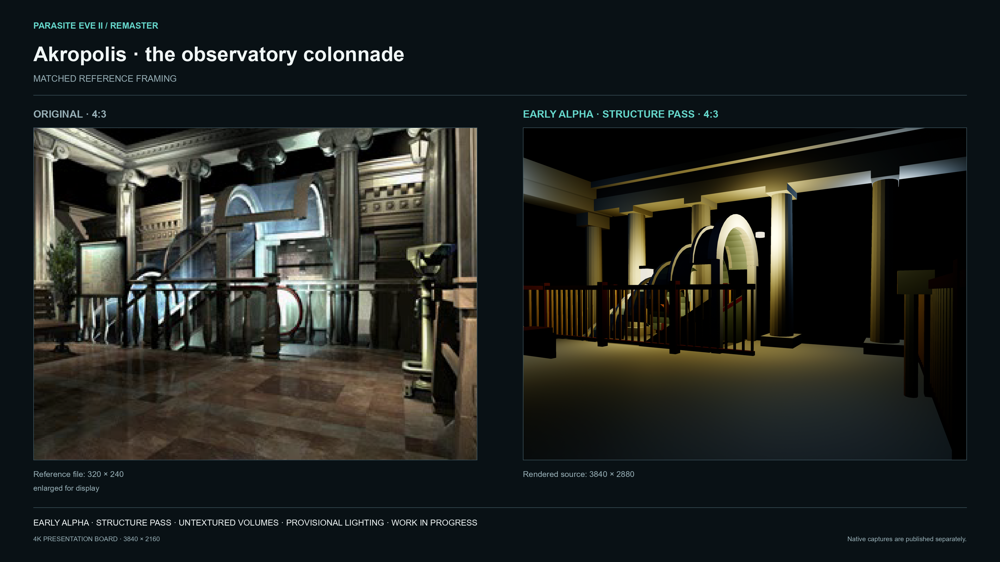](media/alpha/akropolis-observatory-4x3.png)
*La colonnade du belvédère et sa trémie d’escalator · passe de structure · [capture native 3840 × 2880](media/alpha/akropolis-observatory-4x3.png)*

[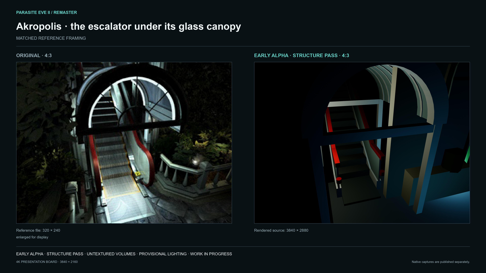](media/alpha/akropolis-escalator-4x3.png)
*L’escalator sous sa verrière, sur la promenade en plein air · passe de structure · [capture native 3840 × 2880](media/alpha/akropolis-escalator-4x3.png)*

[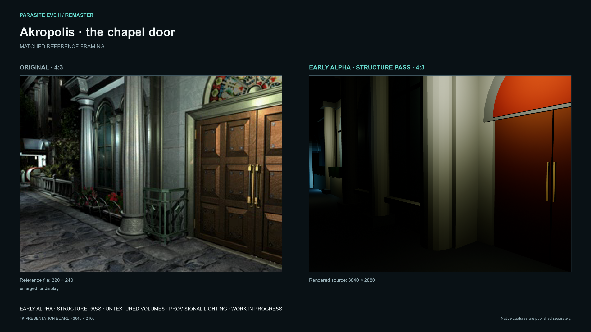](media/alpha/akropolis-chapel-door-4x3.png)
*La porte de la chapelle et son vitrail en demi-lune · passe de structure · [capture native 3840 × 2880](media/alpha/akropolis-chapel-door-4x3.png)*

Les matières, les détails sculptés et le véritable éclairage viendront ensuite, zone par zone.

### Pourquoi montrer aussi du 16:9 ?

Les références originales sont en **4:3**. Elles restent la base pour comparer la disposition et la composition.

L’**image 16:9** conserve le même champ de vision vertical que la référence 4:3. La zone 4:3 centrée (2880 des 3840 pixels) correspond donc au cadrage de référence, et les 480 pixels de chaque côté montrent un espace reconstruit supplémentaire. Le [repère de cadrage](media/wide/mist-view15-guide.png) délimite la zone 4:3 ; la [capture native 16:9](media/wide/mist-view15-16x9.png) est publiée intacte.

[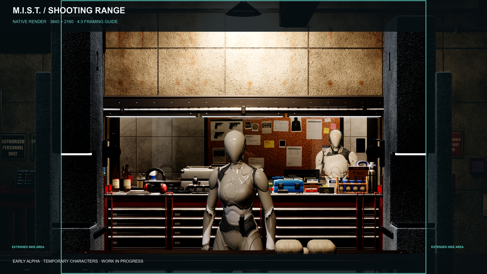](media/wide/mist-view15-16x9.png)

Le champ de tir vu depuis le pas de tir, avec le même cadre 4:3 :

[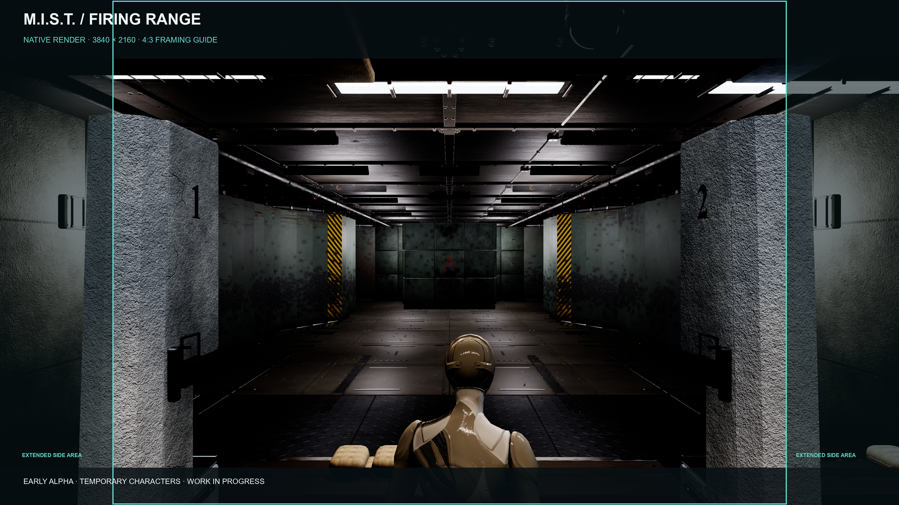](media/wide/mist-range-16x9.png)

L’armurerie, avec le même cadre 4:3 :

[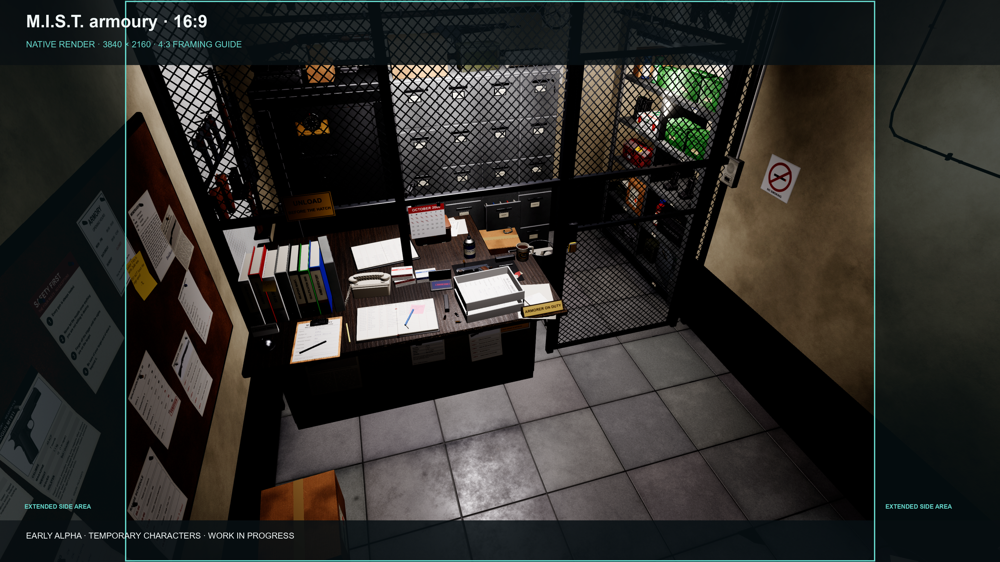](media/wide/mist-armoury-16x9.png)

[Autres vues en 16:9 : les stands, la salle de surveillance, le sas →](docs/GALLERY.fr.md#autres-vues-en-169)

## La suite

- Faire passer Akropolis de sa structure à des espaces terminés : matières, détails sculptés, éclairage.
- Étendre le M.I.S.T. à ses autres espaces connectés, et donner à davantage d’objets la nouvelle destruction pièce par pièce.
- Renforcer la fidélité et les interactions du décor.
- Consolider les commandes, les collisions et les performances.
- Dans le laboratoire Aya : adapter le rechargement tactique et l’inspection courte, puis ajouter la visée vers le haut et vers le bas et les sons du pistolet.
- Poursuivre la recherche de l’apparence définitive d’Aya, et intégrer les systèmes du laboratoire au projet principal une fois qu’ils seront solides.

Les textes sont prévus en **anglais et en français**. Les voix et les cinématiques sont des pistes pour une phase ultérieure, pas des fonctionnalités de l’alpha actuelle.

Le projet avance sur mon temps libre : **aucune date de sortie ni estimation de délai**. Ce dépôt ne contient pas de version jouable publique.

## Vos retours sont les bienvenus

Si vous connaissez bien PE2, vos remarques sur l’éclairage, les matières, la disposition et l’ambiance m’intéressent. Une capture de référence accompagnée d’une observation précise est particulièrement utile.

[Guide des retours](CONTRIBUTING.md) · [Avancement](docs/PROGRESS.fr.md) · [Crédits et notes sur les images](NOTICE.md)

*Parasite Eve II appartient à ses créateurs et ayants droit d’origine. Ce projet de fan est indépendant et non officiel, sans affiliation ni approbation de Square Enix. Cette vitrine contient de la documentation et des images sélectionnées ; elle ne distribue ni le jeu original ni ses ressources extraites.*
