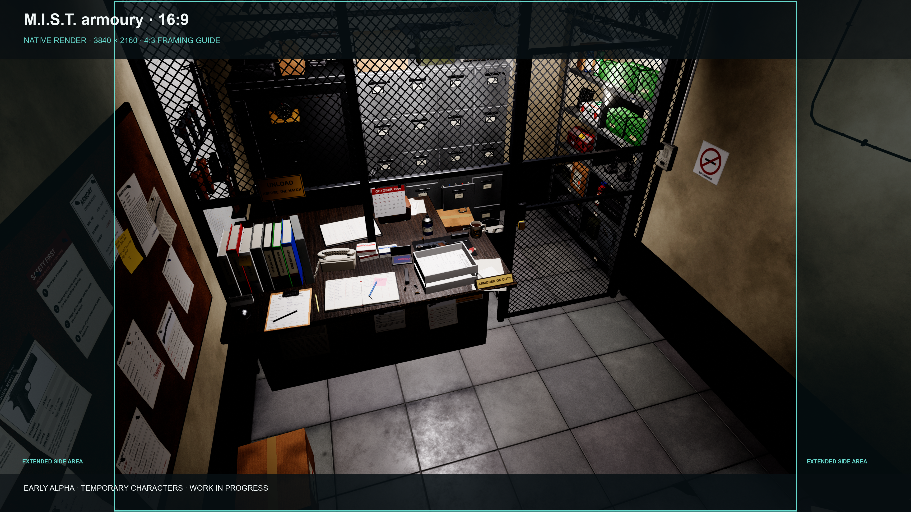

  

Title screen

<h1 align="center">PARASITE EVE II · REMASTER</h1>

<strong>A familiar place. Rebuilt down to the details.</strong>

Unofficial fan project · Early alpha · Unreal Engine · Made in my spare time

<strong>English</strong> · <a href="README.fr.md">Français</a>

I’m rebuilding the world of **Parasite Eve II**, starting with **M.I.S.T.**: its shooting range, service spaces and the small details that make the location recognisable.

The aim is to preserve that familiarity while giving the environment real depth, convincing materials and objects that respond to what happens around them. A surface impact, a broken bottle or a damaged light should leave a visible trace.

This repository is a public progress showcase. The project is an **early development alpha**, with temporary characters and unfinished systems. Rebuilding the entire game is a long-term ambition; the images shown here are centred on M.I.S.T., while a separate lab works on the playable character.

Unreal Engine capture · early alpha · temporary characters · 3840 × 2160

## What’s new · October 2026

**M.I.S.T. keeps growing.** Past the shooting range and the airlock, the alpha now reaches the service corridor, the restricted area and its armoury, and the underground car park, each rebuilt against the original fixed views.

**Destruction with a cause.** Every round lands where it is aimed and carries its energy through what it hits. It crosses a pane and reaches the gun behind it; a hinge bends, then breaks; a freed door drops to the floor; a support gives way and the guns tip over; a tile bursts off its wall; an extinguisher vents and falls. The damage stays in place and can be saved and restored.

**A new location: Akropolis.** The whole Akropolis area has been mapped and rebuilt as a walkable structure: seventeen zones linked by twenty working doors, with more than two hundred original fixed views in place. The first decor pass has started on the open-air promenade, the chapel and the observatory. Materials and lighting are still to come.

The M.I.S.T. armoury · original reference (left) and early alpha (right) · board 3840 × 2160

## Inside the current alpha

<!-- ALPHA_STATUS_START -->
- **Rebuilt so far:** the M.I.S.T. shooting range, the monitoring room behind its service window, the airlock vestibule with its weapon cabinets, the service corridor, the restricted area and its armoury, and the underground car park, matched against the original fixed views. Akropolis exists as a walkable structure with its first decor.
- **Environment detail:** work counters and drawer units, cases and ammunition boxes, notice boards and printed notices, overhead fittings, a handgun rack and long-gun cabinets.
- **Materials and lighting:** concrete, painted and worn metal, wood, canvas and glass, with ongoing work on wear, reflections and readability.
- **Environmental reactions:** surface impacts, breakable bottles, physical props, reaction sounds and lights that can be damaged. The weapon cabinets, a tiled wall and the fire extinguisher now break piece by piece, where they are hit.
- **State tracking:** holes, marks, fallen doors, tipped guns and a venting extinguisher are saved and restored exactly within the development session. A complete game-save system remains unfinished.

Performance, collision checks and visual polish are still being worked on. The final characters are not yet integrated: the mannequins are temporary, and the new pictures show the places without any character.
<!-- ALPHA_STATUS_END -->

## The Aya lab

Character work has started, in a space of its own: a separate Unreal lab where I develop Aya’s movement, posture, aiming and pistol handling, and test them before anything goes into the main project.

- **Movement:** idle, walk, run, moving while aiming and side steps, with a straightened posture, breathing and small movements at rest.
- **Aiming and grip:** her own aiming pose, corrected arms and wrists, the pistol held in her own hand, a support hand placed as shooting manuals describe, the index finger on the trigger.
- **Reloads:** an empty reload rebuilt step by step: slide locked back, empty magazine dropped, fresh magazine, slide released. The tactical reload and the short inspection are prototyped and still need adapting.
- **Firing feedback:** slide movement, arm recoil, a varying muzzle flash, and casings that bounce, roll and settle.
- **An experiment:** a small easter egg for players who insist on reloading a full weapon.

The character animated in the lab is a temporary female base model, not Aya, whose final look is still being researched. None of this is in the main project yet, and there are no new character images for now. [Read the full lab update →](docs/PROGRESS.md#the-aya-lab--update-of-12-october-2026)

## Original framing, rebuilt environments

<!-- COMPARISONS_START -->
Each board puts the **original** (left) next to the **early alpha** (right) at the same reference framing. Click a board to open the untouched native capture (3840 × 2880). The original is a 320 × 240 reference, enlarged for display only. The characters are temporary mannequins.

*M.I.S.T. shooting range · board 3840 × 2160 · [native capture 3840 × 2880](media/alpha/mist-view15-4x3.png)*

*Monitoring room · board 3840 × 2160 · [native capture 3840 × 2880](media/alpha/mist-pierce-4x3.png)*

*Airlock vestibule with its weapon cabinets and notice boards · board 3840 × 2160 · [native capture 3840 × 2880](media/alpha/mist-vestibule-4x3.png)*

*The armoury behind its mesh cage · board 3840 × 2160 · [native capture 3840 × 2880](media/alpha/mist-armoury-4x3.png)*

*The restricted area door and its keypad · board 3840 × 2160 · [native capture 3840 × 2880](media/alpha/mist-restricted-door-4x3.png)*

*The service corridor toward the firearms store · board 3840 × 2160 · [native capture 3840 × 2880](media/alpha/mist-corridor-4x3.png)*

Early alpha: the character poses are not matched to the originals, and every space will get another detailed pass. More views are added as they are rebuilt.
<!-- COMPARISONS_END -->

## Destruction you can read

Shooting in this alpha is meant to leave a story behind. A round meets a point, a part and a material; what happens next follows from that, never from a global health bar. Glass takes a hole and lets the round continue with less energy, a lock or a hinge can be destroyed on its own, a door that has nothing left to hold it falls and lies on the floor, and the pieces settle where they land.

*The airlock vestibule at the same original view, before and after a few rounds: a pane holed, the lock and the hinges shot, the glass door down · [before](media/alpha/mist-vestibule-before-4x3.png) · [after](media/alpha/mist-vestibule-after-4x3.png)*

The same rules work at any frame rate, and the whole state of a broken cabinet can be saved and restored exactly.

## Next stop: Akropolis

Akropolis is being rebuilt the same way, starting from its structure. Every zone, every doorway and every original fixed view of the area is in place and walkable; the first decor pass gives the main volumes their real shape. What you see below is that **structure pass**: untextured volumes and provisional lighting, laid over the original framings to check the layout before any detail is added.

*The observatory colonnade and its escalator well · structure pass · [native capture 3840 × 2880](media/alpha/akropolis-observatory-4x3.png)*

*The escalator under its glass canopy, on the open-air promenade · structure pass · [native capture 3840 × 2880](media/alpha/akropolis-escalator-4x3.png)*

*The chapel door and its stained-glass lunette · structure pass · [native capture 3840 × 2880](media/alpha/akropolis-chapel-door-4x3.png)*

Materials, sculpted details and the real lighting come next, zone by zone.

### Why also show 16:9?

The original references use **4:3**. They remain the baseline for judging the layout and composition.

The **16:9 image** keeps the same vertical field of view as the 4:3 reference. The centred 4:3 area (2880 of the 3840 pixels) therefore matches the reference framing, and the 480 pixels on each side show additional rebuilt space. The [framing guide](media/wide/mist-view15-guide.png) outlines the 4:3 area; the [native 16:9 capture](media/wide/mist-view15-16x9.png) is published untouched.

The firing range seen from the firing line, with the same 4:3 frame:

The armoury, with the same 4:3 frame:

[More widescreen views: the stands, the monitoring room, the airlock →](docs/GALLERY.md#more-widescreen-views)

## What comes next

- Bring Akropolis from its structure to finished spaces: materials, sculpted details, lighting.
- Extend M.I.S.T. into its remaining connected spaces, and give more of its objects the new piece-by-piece destruction.
- Continue improving the environment’s fidelity and interactions.
- Consolidate controls, collisions and performance.
- In the Aya lab: adapt the tactical reload and the short inspection, then add aiming up and down and the pistol’s sounds.
- Keep researching Aya’s final look, and bring the lab’s systems into the main project once they hold up.

The planned text languages are **English and French**. Voice acting and cinematic work are possibilities for a later phase, not current alpha features.

I work on this in my spare time, so there is **no release date or ETA**. No public playable build is included in this repository.

## Feedback welcome

If you know PE2 well, I’d love your thoughts on the lighting, materials, layout and atmosphere. A reference screenshot with a specific observation is especially useful.

[Read the feedback guide](CONTRIBUTING.md) · [Current progress](docs/PROGRESS.md) · [Credits and image notes](NOTICE.md)

*Parasite Eve II is the work of its original creators and rights holders. This is an independent, unofficial fan project with no affiliation or endorsement from Square Enix. This showcase contains project documentation and selected images; it does not distribute the original game or extracted game assets.*
