# Galerie de captures

[Projet](../README.fr.md) · [English](GALLERY.md)

Voir aussi l’[évolution en images](EVOLUTION.fr.md) de chaque plan du M.I.S.T. au fil d’octobre 2026.

## Comparaisons aux mêmes cadrages

<!-- GALLERY_START -->
Original à gauche, alpha précoce à droite, au cadrage de référence correspondant. Cliquez sur une planche pour la capture native intacte. La référence originale garde sa définition réelle (320 × 240) et n’est agrandie que pour la présentation.

### Stand de tir du M.I.S.T.

[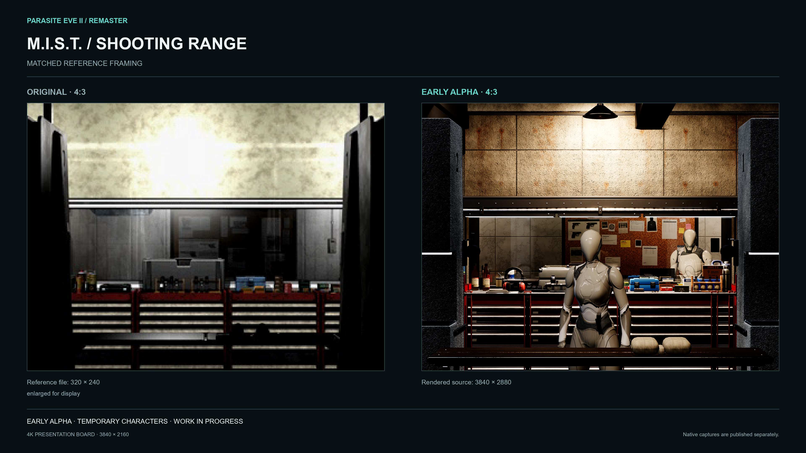](../media/alpha/mist-view15-4x3.png)

Planche 3840 × 2160 · [capture native 3840 × 2880](../media/alpha/mist-view15-4x3.png) · personnages provisoires.

### Hall du stand de tir

[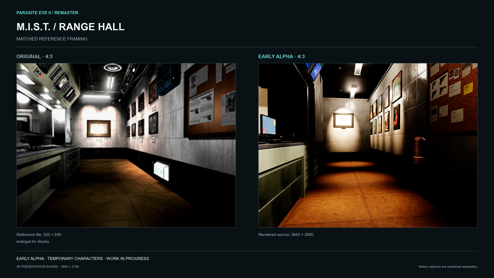](../media/alpha/mist-hall-4x3.png)

Planche 3840 × 2160 · [capture native 3840 × 2880](../media/alpha/mist-hall-4x3.png) · aucun personnage dans le champ.

### Salle de surveillance

[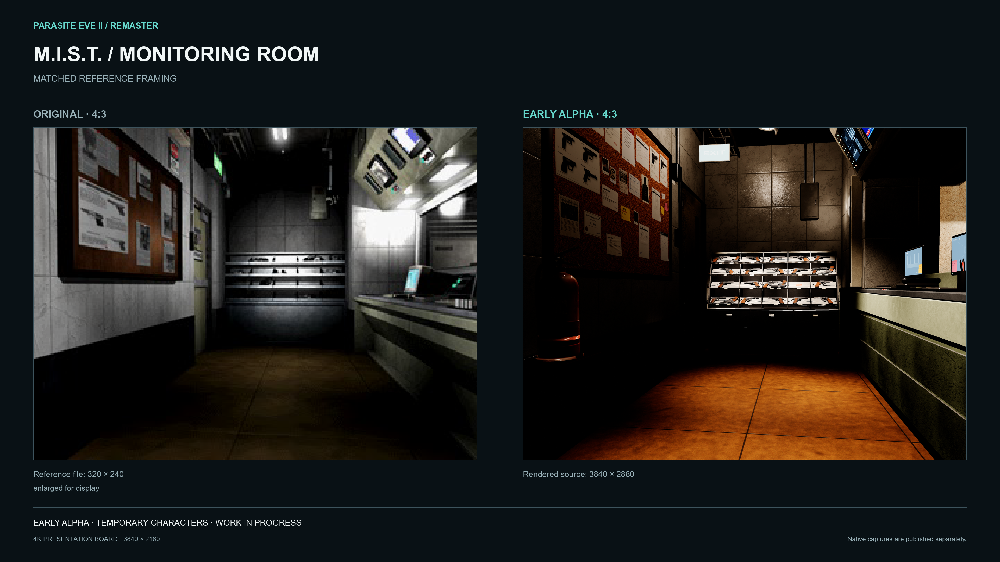](../media/alpha/mist-pierce-4x3.png)

Planche 3840 × 2160 · [capture native 3840 × 2880](../media/alpha/mist-pierce-4x3.png) · personnage provisoire.

### Sas-vestibule

[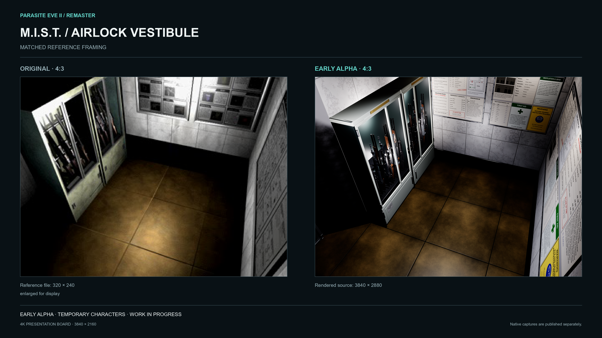](../media/alpha/mist-vestibule-4x3.png)

Planche 3840 × 2160 · [capture native 3840 × 2880](../media/alpha/mist-vestibule-4x3.png) · aucun personnage dans le champ.

### L’armurerie du M.I.S.T.

[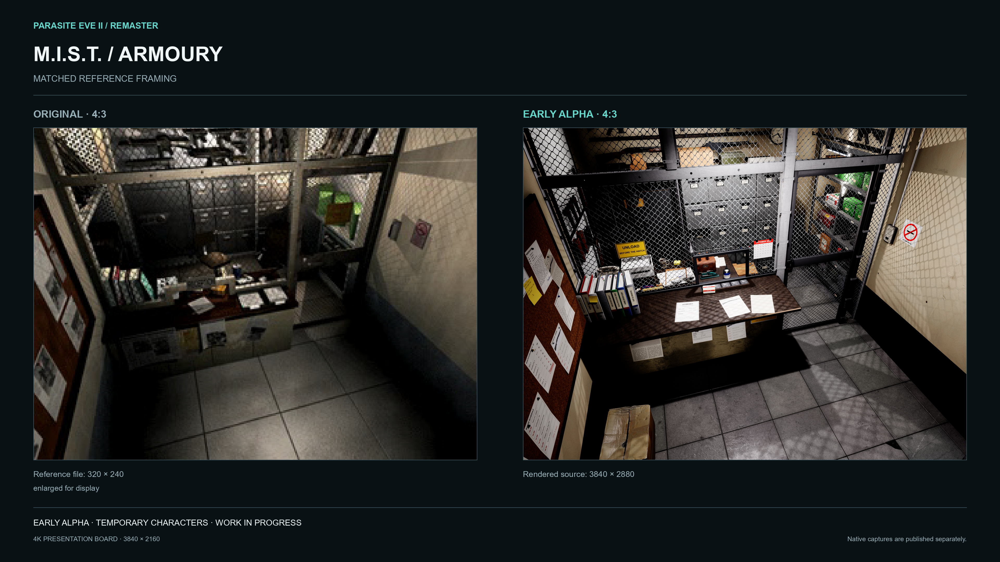](../media/alpha/mist-armoury-4x3.png)

Planche 3840 × 2160 · [capture native 3840 × 2880](../media/alpha/mist-armoury-4x3.png) · aucun personnage dans le champ.

### L’armurerie du M.I.S.T. · avant et après la passe de détail

[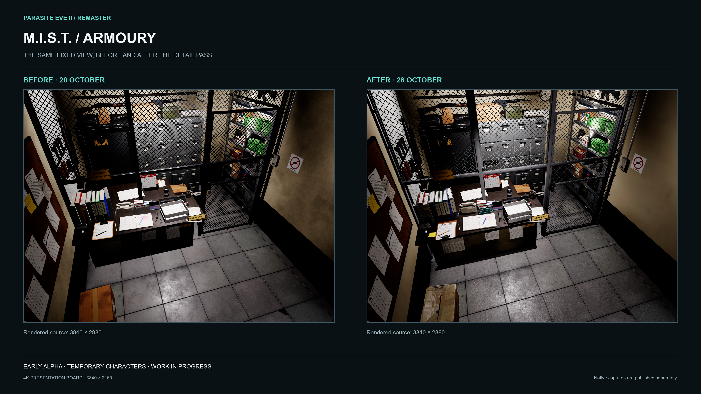](../media/alpha/mist-armoury-4x3.png)

Planche 3840 × 2160 · [avant](../media/alpha/mist-armoury-before-4x3.png) · [après](../media/alpha/mist-armoury-4x3.png) · aucun personnage dans le champ.

### Porte de la zone d’accès restreint

[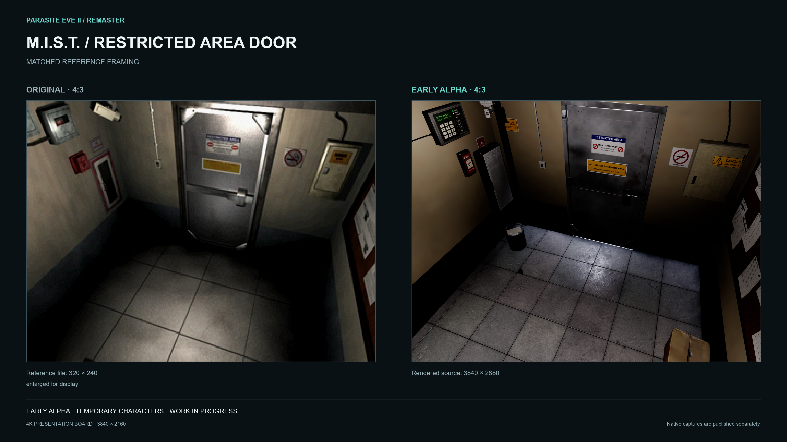](../media/alpha/mist-restricted-door-4x3.png)

Planche 3840 × 2160 · [capture native 3840 × 2880](../media/alpha/mist-restricted-door-4x3.png) · aucun personnage dans le champ.

### Couloir de service

[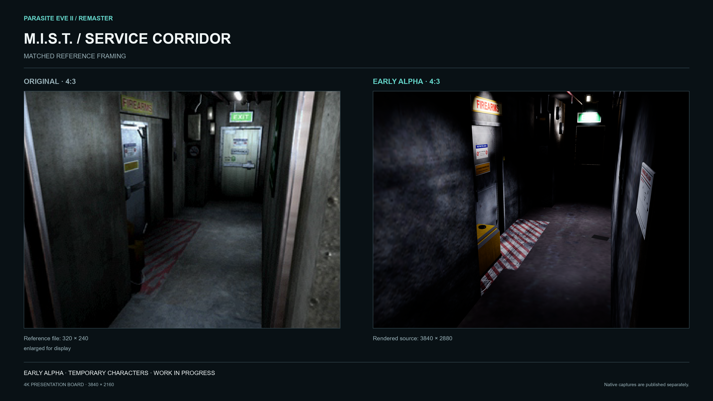](../media/alpha/mist-corridor-4x3.png)

Planche 3840 × 2160 · [capture native 3840 × 2880](../media/alpha/mist-corridor-4x3.png) · aucun personnage dans le champ.

### Akropolis · colonnade du belvédère

[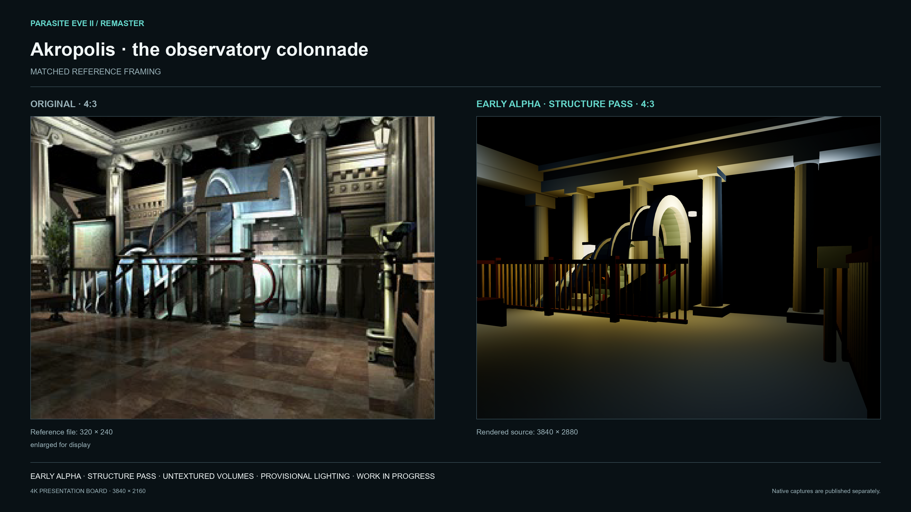](../media/alpha/akropolis-observatory-4x3.png)

Planche 3840 × 2160 · [capture native 3840 × 2880](../media/alpha/akropolis-observatory-4x3.png) · passe de structure : volumes sans textures, éclairage provisoire.

### Akropolis · escalator sous sa verrière

[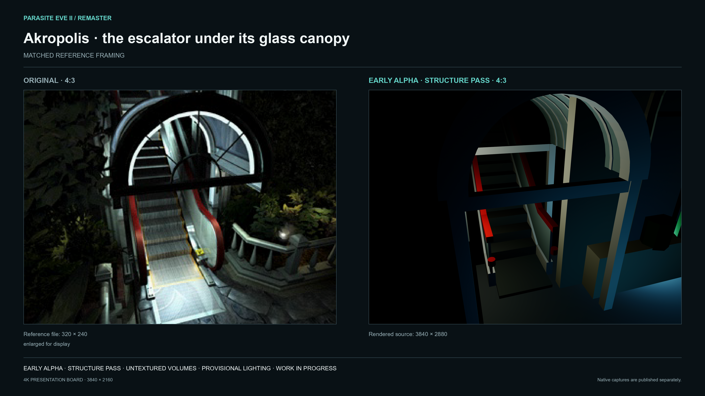](../media/alpha/akropolis-escalator-4x3.png)

Planche 3840 × 2160 · [capture native 3840 × 2880](../media/alpha/akropolis-escalator-4x3.png) · passe de structure : volumes sans textures, éclairage provisoire.

### Akropolis · porte de la chapelle

[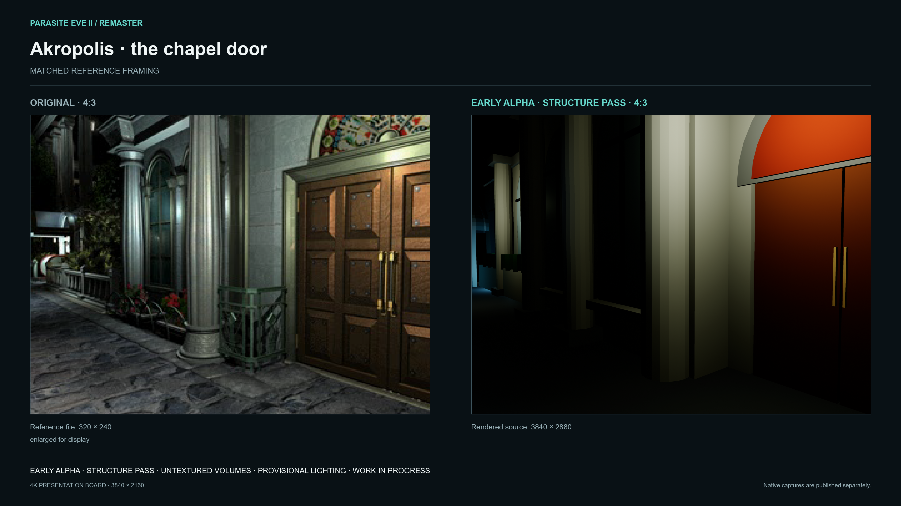](../media/alpha/akropolis-chapel-door-4x3.png)

Planche 3840 × 2160 · [capture native 3840 × 2880](../media/alpha/akropolis-chapel-door-4x3.png) · passe de structure : volumes sans textures, éclairage provisoire.

### Sas-vestibule · avant et après quelques tirs

[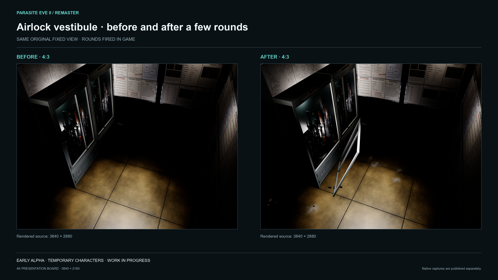](../media/alpha/mist-vestibule-after-4x3.png)

Planche 3840 × 2160 · le même plan fixe d’origine, avant et après des tirs en jeu · [avant](../media/alpha/mist-vestibule-before-4x3.png) · [après](../media/alpha/mist-vestibule-after-4x3.png).
<!-- GALLERY_END -->

## Présentation panoramique

Le 4:3 reste la base des comparaisons avec l’original. Les captures en 16:9 présentent séparément une vue plus large du décor reconstruit. Elles doivent conserver les proportions et expliquer les différences de cadrage visibles.

[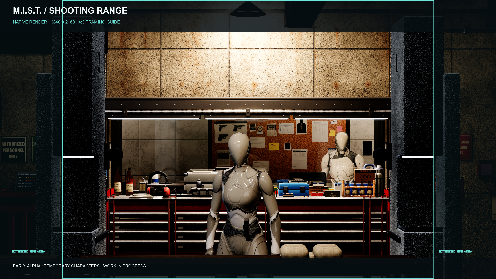](../media/wide/mist-view15-16x9.png)

L’image 16:9 conserve le champ de vision vertical de la référence 4:3 : la zone 4:3 centrée (2880 px) correspond au cadrage de référence et les 480 px de chaque côté montrent un espace reconstruit supplémentaire. La [capture native 16:9](../media/wide/mist-view15-16x9.png) est intacte ; le repère délimite la zone 4:3.

## Autres vues en 16:9

Chaque image est un rendu natif 16:9 depuis une caméra fixe d’origine. Le cadre vert marque la zone 4:3 du cadrage original ; les côtés assombris montrent l’espace supplémentaire visible dans la vue large. Cliquez sur une image pour la capture intacte.

### Champ de tir, depuis le pas de tir

[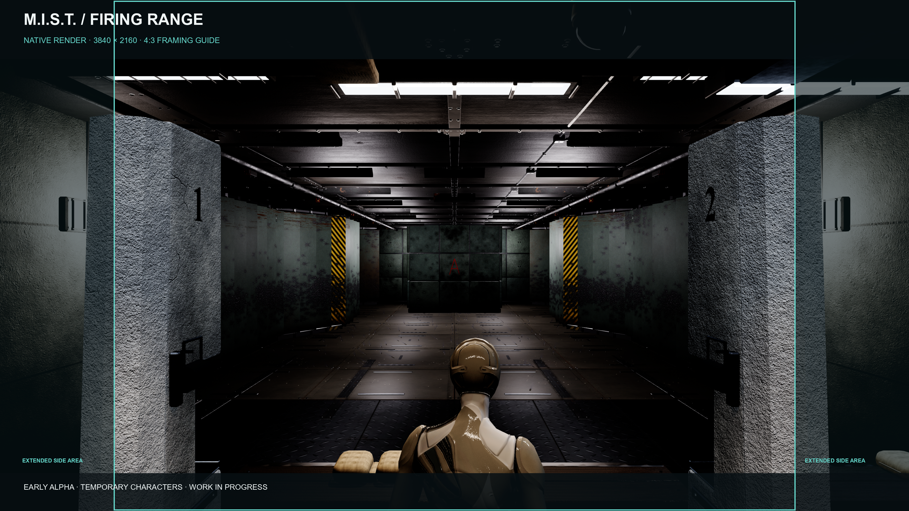](../media/wide/mist-range-16x9.png)

[capture native 16:9 3840 × 2160](../media/wide/mist-range-16x9.png)

### Stands 2 et 3, vers la porte de sortie

[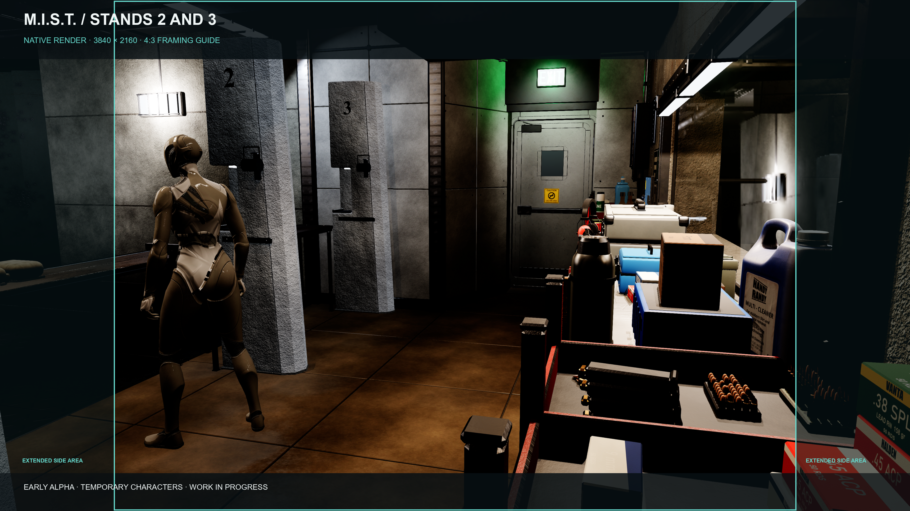](../media/wide/mist-firing-line-west-16x9.png)

[capture native 16:9 3840 × 2160](../media/wide/mist-firing-line-west-16x9.png)

### Stands 1 et 4, vers le guichet

[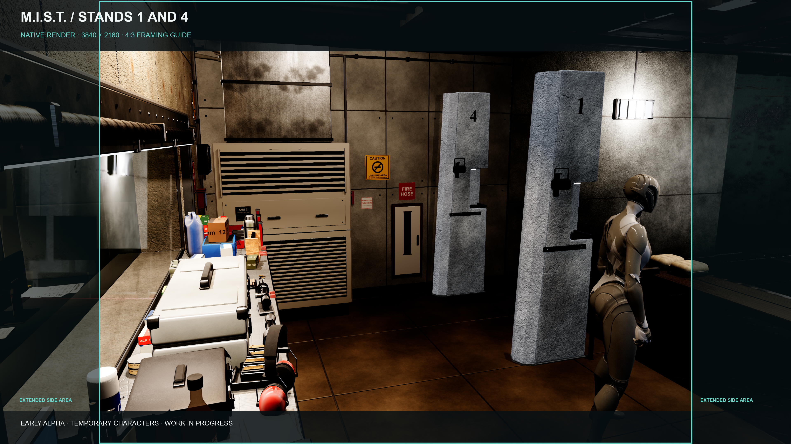](../media/wide/mist-firing-line-east-16x9.png)

[capture native 16:9 3840 × 2160](../media/wide/mist-firing-line-east-16x9.png)

### Salle de surveillance

[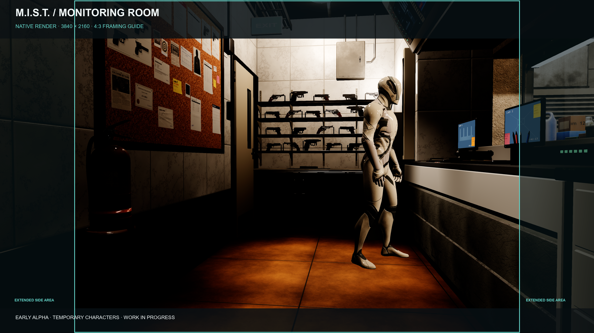](../media/wide/mist-pierce-16x9.png)

[capture native 16:9 3840 × 2160](../media/wide/mist-pierce-16x9.png)

### Sas-vestibule

[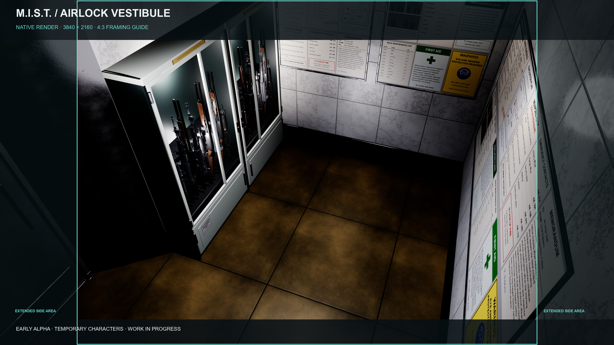](../media/wide/mist-vestibule-16x9.png)

[capture native 16:9 3840 × 2160](../media/wide/mist-vestibule-16x9.png)
